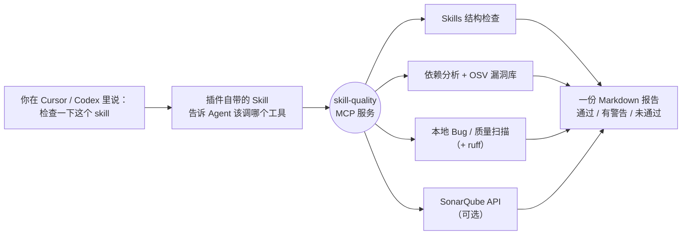

<div align="center">

# Skill Quality MCP

**一个 MCP 服务 + 一个 Agent Skill，给 Cursor 和 Codex 装上“质检员”**

检查 Agent Skill 写得对不对 · 依赖有没有坑 · 代码里藏了哪些 Bug · SonarQube 门禁过没过

[](LICENSE)
[](https://www.python.org/downloads/)
[](https://modelcontextprotocol.io)
[](#cursor)
[](#codex)
[](#sonarqube-配置可选)
[](https://github.com/LoveMuZiLi/skill-quality-mcp/stargazers)

[快速开始](#快速开始) · [能做什么](#能做什么) · [报告示例](#报告长什么样) · [工具清单](#工具清单) · [SonarQube](#sonarqube-配置可选) · [常见问题](#常见问题) · [English](#english)

</div>

---

## 能做什么

<table>
<tr>
<td width="50%" valign="top">

### Agent Skills 检查

- `SKILL.md` frontmatter：`name` 格式、与目录名一致、`description` 长度和触发词
- 正文是否超过 500 行
- 失效的相对链接和 `#锚点`
- 文中提到的脚本 / 文件是否真的存在
- 本机多个技能重名

</td>
<td width="50%" valign="top">

### 依赖分析

- 第三方包：装没装、写没写进 `requirements.txt` / `pyproject.toml`
- 声明了却没用到的包
- 代码自己往 `sys.path` 塞的私有目录（换机器就失效）
- 模块循环依赖、外部命令（ffmpeg、git…）是否在 PATH
- **OSV 已知漏洞**，并给出建议升级的版本

</td>
</tr>
<tr>
<td width="50%" valign="top">

### Bug 检测与代码质量

- 28 条本地规则：Bug、漏洞、安全热点、代码异味
- 认知复杂度、超长函数、重复代码、技术债
- 按 SonarQube 口径给出 **A–E 评级**
- 装了 [ruff](https://docs.astral.sh/ruff/) 会自动合并它的结果

</td>
<td width="50%" valign="top">

### SonarQube / SonarCloud

- 拉取未解决的问题、安全热点
- 项目指标与**质量门禁**状态
- 用 sonar-scanner（或 npx）扫描并上传
- 没配置也能用，报告自动只用本地规则

</td>
</tr>
</table>

## 工作原理



## 快速开始

> [!NOTE]
> 唯一前提：**Python 3.10+** 在 PATH 上（Windows 安装时勾选 “Add to PATH”）。MCP SDK 等依赖会自动安装。

### 一行命令，同时装进 Cursor 和 Codex

**Windows**（PowerShell）

```powershell
irm https://raw.githubusercontent.com/LoveMuZiLi/skill-quality-mcp/main/install.ps1 | iex
```

**macOS / Linux**

```bash
curl -fsSL https://raw.githubusercontent.com/LoveMuZiLi/skill-quality-mcp/main/install.sh | bash
```

装完之后：Cursor 里运行 **Developer: Reload Window**；Codex **新开一个对话**。

> [!TIP]
> 直连不了 github.com？Windows 脚本会自动沿用系统代理；macOS / Linux 先执行 `export HTTPS_PROXY=http://127.0.0.1:7890`（换成你的代理端口）。

### 只装其中一边

<details id="codex">
<summary><b>Codex</b></summary>

```bash
codex plugin marketplace add LoveMuZiLi/skill-quality-mcp
codex plugin add skill-quality@skill-quality-mcp
```

或者用安装脚本：Windows 加 `-CodexOnly`，macOS / Linux 加 `--codex-only`。

</details>

<details id="cursor">
<summary><b>Cursor</b></summary>

**方式一：插件（MCP + Skill，推荐）**

把仓库里的 `plugins/skill-quality` 整个复制到：

| 系统 | 目录 |
| --- | --- |
| Windows | `%USERPROFILE%\.cursor\plugins\local\skill-quality` |
| macOS / Linux | `~/.cursor/plugins/local/skill-quality` |

然后 **Developer: Reload Window**。必须是真实复制，指向别处的符号链接会被 Cursor 忽略。也可以用安装脚本：Windows 加 `-CursorOnly`，macOS / Linux 加 `--cursor-only`。

**方式二：一键只装 MCP**（需要先装 [uv](https://docs.astral.sh/uv/)）

[](https://cursor.com/en/install-mcp?name=skill-quality&config=eyJjb21tYW5kIjoidXZ4IiwiYXJncyI6WyItLWZyb20iLCJnaXQraHR0cHM6Ly9naXRodWIuY29tL0xvdmVNdVppTGkvc2tpbGwtcXVhbGl0eS1tY3AiLCJza2lsbC1xdWFsaXR5LW1jcCJdfQ%3D%3D)

</details>

<details>
<summary><b>其他 MCP 客户端</b>（Claude Desktop、Windsurf、VS Code…）</summary>

```bash
pip install git+https://github.com/LoveMuZiLi/skill-quality-mcp
```

```json
{
  "mcpServers": {
    "skill-quality": { "command": "skill-quality-mcp" }
  }
}
```

不想安装，也可以用 uv 直接运行：

```json
{
  "mcpServers": {
    "skill-quality": {
      "command": "uvx",
      "args": ["--from", "git+https://github.com/LoveMuZiLi/skill-quality-mcp", "skill-quality-mcp"]
    }
  }
}
```

</details>

## 怎么用

装好后不用记工具名，直接在 Cursor / Codex 对话里说：

- “检查一下 **drama-commentary** 这个 skill 的质量”
- “扫描 `D:\project` 的 bug 和依赖漏洞”
- “这个项目的 SonarQube 质量门禁过了吗？”
- “列出我电脑上所有的 skill，看看有没有重名的”

插件自带的 Skill 会引导 Agent：先出报告 → 按严重度列问题 → 你同意后再改 → 改完重跑对比。

## 报告长什么样

下面是对一个故意埋了 Bug 的测试文件跑 `full_quality_report` 的真实输出（节选）：

> **结论：未通过**。本地扫描发现 9 个严重 Bug/漏洞；依赖未完整声明；3 个安全热点待人工确认
>
> 1 个文件、32 行代码、5 个函数；重复行 0.0%；技术债约 55 分钟（5.7%）
>
> | 可靠性 | 安全性 | 可维护性 | Bug | 漏洞 | 安全热点 | 代码异味 |
> |:---:|:---:|:---:|:---:|:---:|:---:|:---:|
> | C | D | B | 8 | 2 | 3 | 7 |
>
> | 严重度 | 类型 | 规则 | 位置 | 说明 |
> |---|---|---|---|---|
> | CRITICAL | 漏洞 | python:S2068 | buggy.py:6 | API_TOKEN 疑似硬编码密钥/密码，改为环境变量读取 |
> | CRITICAL | 漏洞 | python:S4830 | buggy.py:38 | verify=False 关闭了 TLS 证书校验 |
> | MAJOR | Bug | python:S5905 | buggy.py:17 | assert 一个元组永远为真，括号写错了 |
> | MAJOR | Bug | python:S1143 | buggy.py:33 | finally 里的 return/break/continue 会吞掉正在抛出的异常 |
> | MAJOR | Bug | local:duplicate-def | buggy.py:41 | 函数 fetch 在同一作用域重复定义，前一个被覆盖 |
> | … | | | | |

## 工具清单

| 分类 | 工具 | 作用 |
| --- | --- | --- |
| 一站式 | `full_quality_report` | 技能结构 + 依赖 + 本地扫描 + SonarQube，给出 **通过 / 有警告 / 未通过** |
| Skills | `list_skills` | 列出 Cursor、Codex、Claude 用户目录和插件里的所有技能，提示重名 |
| | `inspect_skill` | 检查单个技能的结构 |
| 依赖 | `analyze_dependencies` | 依赖分析；`check_vulnerabilities=true` 时联网查 OSV |
| 代码质量 | `code_quality_scan` | 本地 Bug 检测和 A–E 评级 |
| SonarQube | `sonar_check_connection` | 检查配置和连通性 |
| | `sonar_issues` | 拉取未解决的问题，可按类型、严重度筛选 |
| | `sonar_project_metrics` | 指标与质量门禁 |
| | `sonar_run_scan` | 扫描并上传（没装 sonar-scanner 时可 `use_npx=true`） |

另附提示词 **`review_skill`**：先出报告，再按严重度给修复方案。

<details>
<summary><b>本地检测规则一览</b>（规则 ID 近似对应 SonarQube 同名规则）</summary>

| 类别 | 规则 |
| --- | --- |
| Bug | 不可达代码（S1763）、`finally` 里 return（S1143）、`is` 比较字面量（S5795）、assert 元组（S5905）、自赋值（S1656）、两侧相同的比较（S1764）、重复定义、可变默认参数 |
| 漏洞 | 硬编码密钥（S2068）、关闭证书校验（S4830）、不安全的 `yaml.load` |
| 安全热点 | `eval` / `exec`（S1523）、`os.system` / `shell=True`（S4721）、`pickle.load`、明文 HTTP（S5332） |
| 代码异味 | 认知复杂度 > 15（S3776）、函数 > 100 行（S138）、参数 > 7 个（S107）、裸 except（S5754）、静默吞异常、`== None`、未用的 import（S1128）和变量（S1481）、重复字符串（S1192）、无占位符的 f-string（S3457）、`open()` 不指定编码、超长行（S103）、TODO（S1135） |
| 度量 | 重复代码密度、技术债、可靠性 / 安全性 / 可维护性评级 |

</details>

## SonarQube 配置（可选）

设置下面的系统环境变量，然后**重启 Cursor / Codex**：

| 变量 | 说明 |
| --- | --- |
| `SONAR_HOST_URL` | 如 `http://localhost:9000`；SonarCloud 用 `https://sonarcloud.io` |
| `SONAR_TOKEN` | SonarQube → My Account → Security 生成 |
| `SONAR_PROJECT_KEY` | 默认项目 key，工具参数可覆盖 |
| `SONAR_ORGANIZATION` | 只有 SonarCloud 需要 |
| `SONAR_SCANNER` | sonar-scanner 不在 PATH 时填完整路径 |
| `SKILL_DIRS` | 额外的技能搜索目录，多个用系统路径分隔符隔开 |

<details>
<summary>设置示例</summary>

**Windows**（PowerShell，永久生效）

```powershell
setx SONAR_HOST_URL "http://localhost:9000"
setx SONAR_TOKEN "squ_xxxxxxxxxxxxxxxx"
setx SONAR_PROJECT_KEY "my-project"
```

**macOS / Linux**（写进 `~/.zshrc` 或 `~/.bashrc`）

```bash
export SONAR_HOST_URL="http://localhost:9000"
export SONAR_TOKEN="squ_xxxxxxxxxxxxxxxx"
export SONAR_PROJECT_KEY="my-project"
```

还没有 SonarQube？本地起一个：`docker run -d -p 9000:9000 sonarqube:community`

</details>

## 常见问题

<details>
<summary><b>装完在 Cursor 里看不到？</b></summary>

运行 **Developer: Reload Window**，然后在 **Customize** 里确认 `skill-quality` 插件已启用。Enterprise 团队需要管理员开启 **Allow Local Plugin Imports**。

</details>

<details>
<summary><b>macOS / Linux 提示找不到 python？</b></summary>

插件用 `python` 命令启动。安装脚本会自动把 Cursor 插件里的命令改成你机器上的 `python3`；Codex 插件需要 `python` 可用：

```bash
ln -s "$(command -v python3)" ~/.local/bin/python
```

</details>

<details>
<summary><b>本地规则和 SonarQube 结果有什么区别？</b></summary>

本地规则只覆盖 Python，是 SonarQube 同名规则的近似实现，适合没有 SonarQube 时快速自查。配置了 SonarQube 后，报告会同时列出两边的结果，以 SonarQube 为准。其他语言请用 SonarQube。

</details>

<details>
<summary><b>怎么升级？</b></summary>

重新运行一次安装命令即可，Cursor 和 Codex 会一起更新到最新版。

</details>

## 仓库结构

```text
skill-quality-mcp/
├── .cursor-plugin/marketplace.json      Cursor 插件市场清单
├── .agents/plugins/marketplace.json     Codex 插件市场清单
├── plugins/skill-quality/
│   ├── .cursor-plugin/plugin.json       Cursor 插件清单
│   ├── .codex-plugin/plugin.json        Codex 插件清单
│   ├── mcp.json                         Cursor 的 MCP 启动配置
│   ├── .mcp.json                        Codex 的 MCP 启动配置
│   ├── server.py                        启动入口（缺 mcp 时自动安装）
│   ├── skill_quality_mcp/               MCP 服务源码
│   └── skills/skill-quality/SKILL.md    教 Agent 何时、如何调用这些工具
├── pyproject.toml                       pip / uvx 安装
├── install.ps1                          Windows 一行安装
└── install.sh                           macOS / Linux 一行安装
```

## English

**Skill Quality MCP** is an MCP server bundled with an Agent Skill, packaged as both a **Cursor plugin** and a **Codex plugin**. It checks Agent Skills (frontmatter, broken links and anchors, missing referenced files), analyzes dependencies (missing / undeclared / unused packages, OSV vulnerabilities with fix versions), runs 28 local bug and code-quality rules with SonarQube-style A–E ratings, and optionally pulls issues, metrics and quality gates from SonarQube / SonarCloud.

```bash
# Windows
irm https://raw.githubusercontent.com/LoveMuZiLi/skill-quality-mcp/main/install.ps1 | iex
# macOS / Linux
curl -fsSL https://raw.githubusercontent.com/LoveMuZiLi/skill-quality-mcp/main/install.sh | bash
# Codex only
codex plugin marketplace add LoveMuZiLi/skill-quality-mcp && codex plugin add skill-quality@skill-quality-mcp
```

## License

[MIT](LICENSE) © LoveMuZiLi
